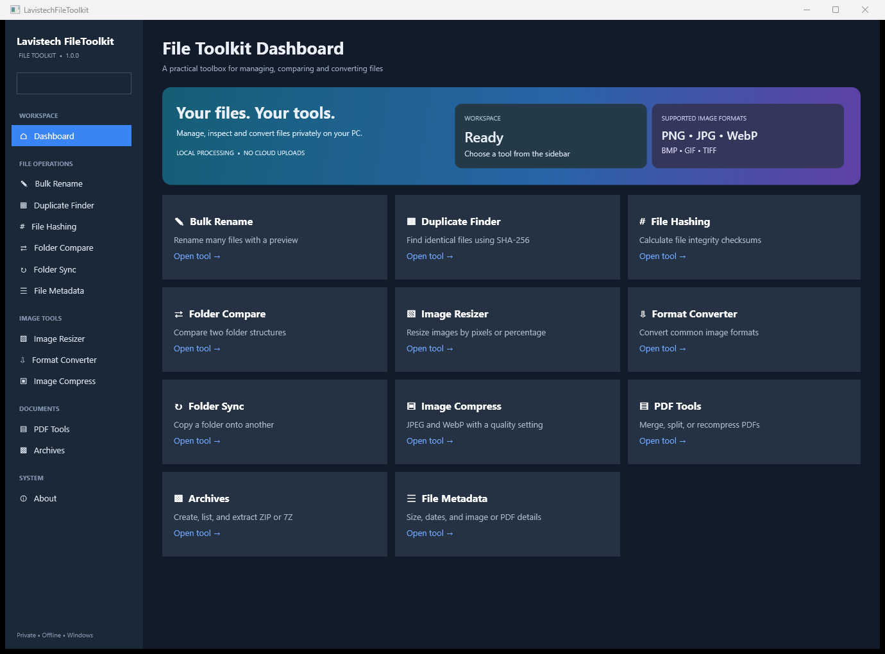

# LAVISTECH FILE TOOLKIT

### File tools that stay on your PC.

A free and open-source Windows desktop app for renaming, comparing, syncing, hashing, compressing, and archiving files locally. Nothing is uploaded.



[Features](#features) |
[Requirements](#requirements) |
[Download](#download) |
[Build from Source](#build-from-source) |
[License](LICENSE)

Put together by [Lavistech Solutions](https://lavistech.com/). Current version: **1.0.0**. Windows PC, 64-bit. The project and executable name is `LavistechFileToolkit`.

Source code: [lavistechsolutions/LavistechFileToolkit](https://github.com/lavistechsolutions/LavistechFileToolkit)

## Features

Open a tool from the dashboard or the sidebar. The sidebar search filters the tool list. Each tool writes to a results box you can copy or clear. **About** opens the version, license, and EULA.

Drop files or folders onto the window while a tool is open.

- **Bulk rename.** Add a prefix or suffix, find and replace in the file name, number files, or use a template: `{name}`, `{ext}`, `{n}`, `{date}`, `{parent}`. Preview lists every change. Apply checks for duplicate destination names and files that already exist, then saves an undo of that run. Undo restores those names when the original name is free. File contents are not modified. The run is not a transaction: if a later move fails, earlier files in that run may already have new names.
- **Duplicate finder.** Scans a folder and its subfolders. Files are grouped when the size and the SHA-256 hash match. Files that cannot be read are skipped. **Recycle extra copies** sends every file except the oldest in each group to the Recycle Bin, after you confirm.
- **File hashing.** MD5, SHA-1, SHA-256, or SHA-512 of the files you pick, printed as lowercase hex. The file is read as a stream.
- **Folder compare.** Compares relative paths in two folders. The default check is path and file size. The content check also compares SHA-256. Files are not modified.
- **Folder sync.** Copies files that are missing from the destination, or newer or a different size. A second mode also sends files that exist only in the destination to the Recycle Bin, after you confirm. One folder must not sit inside the other.
- **File metadata.** Name, path, size, dates, and attributes. Images include pixel size. PDFs include a page count.
- **Image resizer.** Resize by width and height, or by a percentage from 1 to 500. Fit-inside keeps the aspect ratio. Stretch uses the exact size. Output is a PNG copy in a folder you choose. Originals stay where they are.
- **Format converter.** Convert raster images to PNG, JPG, BMP, GIF, or TIFF. JPEG output uses quality 92. Animated images are taken from the first decoded frame. Converted files are new copies. If the destination name exists, a numbered name is used.
- **Image compress.** Writes a JPEG or WebP copy at a quality from 1 to 100 and shows the size before and after. Originals stay where they are.
- **PDF tools.** Merge PDFs in the order you selected, split each PDF into single pages, or rewrite a PDF and compare the file size. Rewriting recompresses PDF streams. It does not downsample images inside the PDF.
- **Archives.** Create a ZIP or 7Z from the selected files, or list and extract an existing ZIP, 7Z, RAR, TAR, or GZ. Extract refuses to write outside the output folder and refuses to overwrite a file that is already there.

## Requirements

Windows 10 or Windows 11, 64-bit.

| What you want to do | What to install |
| --- | --- |
| Build or run from source on this PC | [.NET 10 SDK](https://dotnet.microsoft.com/download/dotnet/10.0) |
| Run a framework-dependent build on another PC | [.NET 10 Desktop Runtime](https://dotnet.microsoft.com/download/dotnet/10.0) |
| Run a self-contained publish | Nothing else. The runtime is included. |

The SDK includes the runtime used to run a local build, so a separate Desktop Runtime install is not required on the machine you build on.

## Download

A self-contained 64-bit build is produced with the publish command in [Build from Source](#build-from-source). Run `LavistechFileToolkit.exe` from `bin\Release\net10.0-windows\win-x64\publish\`. That program includes the .NET runtime, so the PC does not need a separate .NET install.

When a release is published, the file name to attach is `LavistechFileToolkit-win-x64.zip`. It should contain the program plus `LICENSE`, `EULA.txt`, `THIRD-PARTY-NOTICES.txt`, and this README. PDFsharp, SharpCompress, and SkiaSharp travel with the program under their own licenses.

## Build from Source

Install the [.NET 10 SDK](https://dotnet.microsoft.com/download/dotnet/10.0). Open `LavistechFileToolkit.sln` in Visual Studio 2026, or any Visual Studio version with the .NET 10 SDK, and build.

Or from this directory:

```powershell
dotnet build -c Release
```

The executable is written to:

```text
bin\Release\net10.0-windows\LavistechFileToolkit.exe
```

`dotnet build` produces a framework-dependent program. Another PC needs the .NET 10 Desktop Runtime to run that output.

A self-contained build carries the runtime with it, so the target PC does not need .NET installed:

```powershell
dotnet publish .\LavistechFileToolkit.csproj -c Release -r win-x64 --self-contained true -p:PublishSingleFile=true -p:IncludeNativeLibrariesForSelfExtract=true
```

Published files are placed under:

```text
bin\Release\net10.0-windows\win-x64\publish\
```

Keep a backup before you apply a bulk rename, sync a folder, or recycle duplicate copies.

## License

The Lavistech File Toolkit project code is covered by the [MIT License](LICENSE). The [EULA](EULA.txt) covers official builds and does not narrow the MIT License.

PDFsharp and SharpCompress are MIT. SkiaSharp is MIT, and the native Skia library it includes is BSD 3-Clause. Those components keep their own licenses. Details are in [THIRD-PARTY-NOTICES.txt](THIRD-PARTY-NOTICES.txt).

To report a vulnerability, see [SECURITY.md](SECURITY.md). To contribute, see [CONTRIBUTING.md](CONTRIBUTING.md). Release history is in [CHANGELOG.md](CHANGELOG.md).

## Feedback

[lavistech.com/contact](https://lavistech.com/contact)
